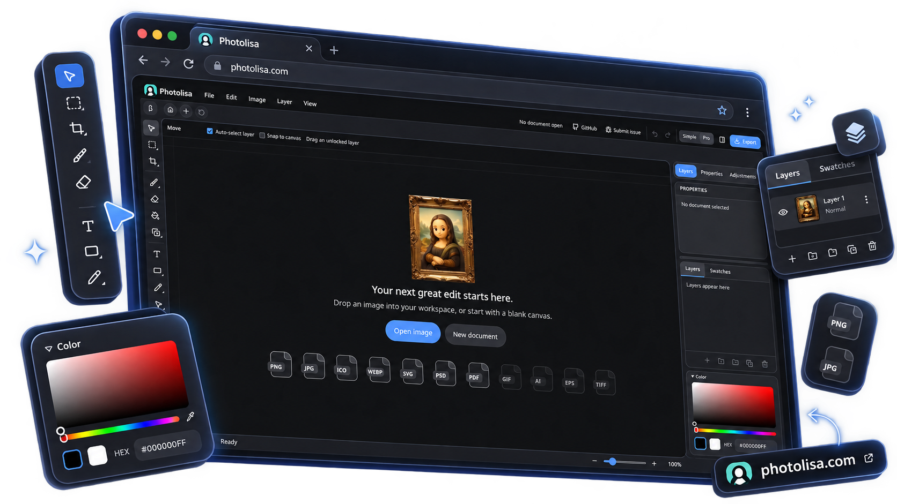

<p align="center">

<a href="https://photolisa.com">
 
</a>

</p>

<div align="center">

# Photolisa

## A modern, open-source, web-based photo editor and alternative to Adobe Photoshop.

<p>
  
  
  
</p>

**[Photolisa.com](https://photolisa.com) · [Live APP](https://photolisa.com/app)**

</div>

<p align="center">
    
</p>

Photolisa is a free, open-source photo editor built with **TypeScript** and **Vue.js**, chosen for their simplicity and accessibility to developers. Released under the **MIT License**. Тhe project combines hand-written code with some AI-assisted development.

Photolisa is still under active development. Some features are unfinished or planned for future releases. Check [Releases](https://github.com/photolisa/photolisa/releases) and [Issues](https://github.com/photolisa/photolisa/issues) for the latest updates.


## 🗺️ Roadmap

- [x] **First Beta Release** — Launch the first public beta of Photolisa.
- [ ] Photo Effects & Filters
- [ ] **Localization** — Introduce multilingual support to make Photolisa accessible worldwide.
- [ ] Custom themes


## 🤝 Contributing

Contributions are always welcome! Whether you're reporting a bug, suggesting a feature, improving documentation, or submitting code, your help makes Photolisa better.

- 🐛 To report application bugs, please use [GitHub issue](https://github.com/photolisa/photolisa/issues)
- For questions or suggestions, please ask them in [GitHub Discussions](https://github.com/photolisa/photolisa/discussions).
- Photolisa is open source. If it saves you time, please <a href="https://github.com/photolisa/photolisa">star us on GitHub</a> to help more developers discover it.

Every contribution, big or small, helps make Photolisa better. Thank you for being part of the project! ❤️


## 🚀 Getting started

To install dependencies and run Photolisa locally, follow these steps:

```bash
npm install
npm run dev
```

---

## Special Thanks

- [Vue](https://vuejs.org/), [Vue Router](https://router.vuejs.org/), [Pinia](https://pinia.vuejs.org/), and [VueUse](https://vueuse.org/): Power the application UI, navigation, UI state, and composables.
- [Vite](https://vite.dev/) and [Tailwind CSS](https://tailwindcss.com/): Build and style the application.
- [PixiJS](https://pixijs.com/): Renders the editor canvas with GPU acceleration.
- [Paper.js](https://paperjs.org/): Provides vector path geometry operations.
- [ag-psd](https://github.com/Agamnentzar/ag-psd): Reads and writes PSD files.
- [pdf-lib](https://pdf-lib.js.org/): Creates PDF exports.
- [PDF.js](https://mozilla.github.io/pdf.js/): Imports and renders PDF pages.
- [icojs](https://github.com/egy186/icojs): Parses ICO files for import.
- [idb](https://github.com/jakearchibald/idb): Stores projects and color data in IndexedDB.
- [Lucide](https://lucide.dev/) and [Iconify](https://iconify.design/): Provide and render icons in the editor UI.

Photolisa is built with these open-source projects. Thank you to their maintainers and contributors. We welcome your contributions, too!

We respect and appreciate the work of all developers. If you believe your license or rights have not been properly respected, or your project requires attribution, please contact us so we can address the issue and add the appropriate credit to the list above.